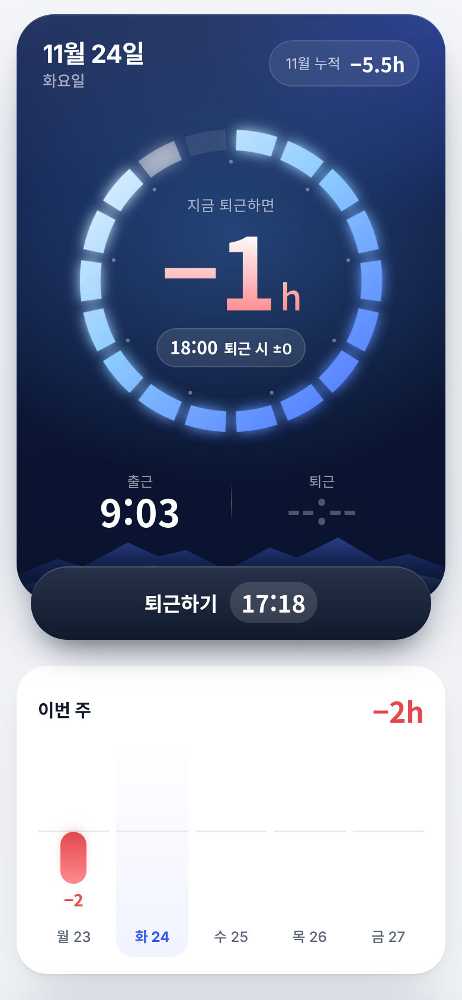
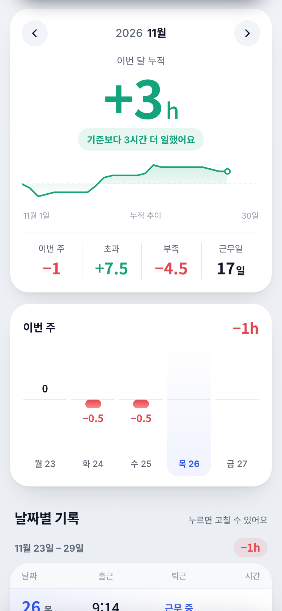
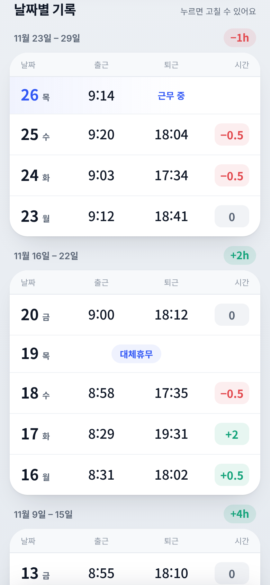

# WorkPace — DYNAFIT 근무시간 앱

구글 시트 `2026 근무시간표_DYNAFIT`와 연동되는 모바일 근무 기록 앱입니다.
폰에서 출근·퇴근을 누르면 해당 월 탭(`YY-MM월 근무시간`)의 날짜 행에 바로 기록됩니다.

- 앱 화면: https://hcm7989.github.io/dynafit-worktime-app/ (GitHub Pages, 홈 화면에 추가하면 전체 화면 앱)
- 서버: 시트에 붙은 Apps Script 웹 앱. 비밀 키가 맞는 요청만 시트를 읽고 씁니다.
- 근무 기록은 구글 시트에만 저장되고 이 저장소에는 올라가지 않습니다.

## 기능

- 출근·퇴근 버튼 하나로 기록. 출근 전에는 출근하기, 근무 중에는 퇴근하기, 퇴근 후에는 퇴근 시간 고치기로 바뀝니다.
- 하루 9시간을 30분 단위 18칸 링으로 표시하고, 지금 퇴근하면 몇 시간인지와 ±0이 되는 퇴근 시각을 보여 줍니다.
- 월 누적 시간을 크게 보여 주고, 누적 추이 그래프와 이번 주·초과·부족·근무일 요약을 함께 보여 줍니다.
- 이번 주(월~금) 막대그래프, 주 단위 표(날짜·출근·퇴근·시간)로 정리한 날짜별 기록을 볼 수 있습니다.
- 날짜별로 시간 수정, 오전·오후 반차, 연차·공휴일·출장 같은 휴가 지정, 메모를 할 수 있습니다.
- 새 달 탭이 없으면 지난달 탭을 복사해 날짜와 주간 합계 수식을 자동으로 만듭니다.

## 시간 계산 규칙

기존 시트 기록 36건과 반차 1건으로 검증했습니다.

| 항목 | 규칙 | 예시 |
|---|---|---|
| 출근 | 30분 단위 올림, 정각·30분에서 5분 이내면 내림 | 9:04 → 9:00, 9:07 → 9:30 |
| 퇴근 | 30분 단위 내림 | 18:41 → 18:30 |
| 시간(±) | (퇴근 − 출근) − 9시간 (점심 포함) | 9:03~18:31 → +0.5 |
| 반차 | (퇴근 − 출근) − 4시간 | 8:56~13:01 → 0 |

유예 시간과 기준 시간은 `Code.gs` 맨 위의 `GRACE_MIN`, `BASE_HOURS`, `HALF_HOURS`에서 바꿀 수 있습니다.
화면 쪽 계산은 `Index.html`의 `GRACE`, `BASE`, `HALF`에서 바꾸며, 두 곳 값을 똑같이 맞춰야 합니다.

## 파일 구성

| 파일 | 역할 |
|---|---|
| `Code.gs` | 시트 읽기·쓰기, 출퇴근 기록, 휴가 처리, 월 탭 자동 생성 |
| `Index.html` | 모바일 화면. GitHub Pages에서는 비밀 키 API로, Apps Script 안에서는 직접 호출로, PC에서 파일로 열면 예시 데이터로 동작합니다 |
| `app/` | 앱 아이콘과 홈 화면 설치 정보(manifest) |
| `appsscript.json` | 프로젝트 설정 (서울 시간대, 웹 앱 권한: 모든 사용자 — 비밀 키로 보호) |
| `.github/workflows/pages.yml` | 앱 화면을 GitHub Pages로 배포 |
| `.github/workflows/deploy.yml` | GitHub Actions 자동 배포 (clasp) |
| `.claspignore` | clasp가 올릴 파일 지정 |

## 설치

### 1. GitHub Pages 켜기 (처음 한 번)

1. 저장소 **Settings → General → 맨 아래 Danger Zone → Change visibility → Public**으로 바꿉니다. 무료 계정은 공개 저장소에서만 Pages를 쓸 수 있습니다. 코드만 공개되고 근무 기록과 비밀 키는 올라가지 않습니다.
2. **Settings → Pages → Build and deployment → Source**를 **GitHub Actions**로 바꿉니다.
3. **Actions → 앱 화면 배포 (GitHub Pages) → Run workflow**를 누릅니다. 초록색 체크가 뜨면 https://hcm7989.github.io/dynafit-worktime-app/ 가 열립니다.

### 2. Apps Script 서버 (시트에서)

1. 구글 시트에서 **확장 프로그램 → Apps Script**를 엽니다.
2. `코드.gs`(또는 `Code.gs`) 내용을 이 저장소의 `Code.gs`로 바꿉니다. `Index` HTML 파일도 `Index.html`로 바꿔 둡니다.
3. **배포 → 배포 관리 → 연필(수정)**을 눌러 **액세스 권한: 모든 사용자**, **버전: 새 버전**으로 바꾸고 배포합니다. 처음이면 **배포 → 새 배포 → 웹 앱**으로 실행 사용자 **나**, 액세스 권한 **모든 사용자**로 배포합니다.
4. 함수 목록에서 `setupApp`을 고르고 **실행**합니다. 권한 경고가 나오면 고급 → 이동 → 허용을 누릅니다.
5. 실행 로그에 나온 **설치 링크**(`https://hcm7989.github.io/dynafit-worktime-app/#u=…&k=…`)를 복사합니다.

> 설치 링크에는 비밀 키가 들어 있습니다. 내 폰에만 보내고 다른 사람과 공유하지 마세요. 키를 바꾸려면 `resetKey`를 실행해 새 링크를 받으면 예전 링크는 더 이상 작동하지 않습니다.

### 3. 폰에 설치

1. 설치 링크를 폰으로 보냅니다 (카카오톡 나에게 보내기 등).
2. 링크를 **Safari(아이폰) 또는 Chrome(갤럭시)**에서 엽니다. 카카오톡 안에서 열렸다면 오른쪽 아래 메뉴에서 **Safari로 열기 / 다른 브라우저로 열기**를 누릅니다.
3. 아이폰은 **공유 → 홈 화면에 추가**, 갤럭시는 **메뉴(⋮) → 홈 화면에 추가**를 누릅니다.
4. 예전에 추가한 Apps Script 주소 아이콘은 지웁니다.

홈 화면 앱을 열었는데 "앱 연결하기" 화면이 나오면 설치 링크 전체를 붙여넣고 **연결하기**를 누르면 됩니다.

### 업데이트

화면(`Index.html`, `app/`)은 `main`에 올라가면 GitHub Pages로 자동 배포되어 폰에 바로 반영됩니다.
서버(`Code.gs`)는 자동 배포를 설정해 두면 변경이 올라갈 때마다 GitHub Actions가 Apps Script에 업로드하고 웹 앱을 새 버전으로 갱신합니다. 폰 주소는 그대로입니다.
자동 배포 없이 할 때는 Apps Script에 코드를 붙여넣고 **배포 → 배포 관리 → 수정 → 버전: 새 버전**으로 다시 배포합니다.

## 자동 배포 설정 (처음 한 번)

GitHub 저장소의 **Settings → Secrets and variables → Actions → New repository secret**에 아래 3개를 등록합니다.

| 시크릿 이름 | 값 | 찾는 곳 |
|---|---|---|
| `SCRIPT_ID` | Apps Script 프로젝트 ID | Apps Script 편집기 **프로젝트 설정(톱니바퀴) → ID → 스크립트 ID** |
| `DEPLOYMENT_ID` | 지금 쓰는 웹 앱 배포 ID (`AKfycb…`) | **배포 → 배포 관리** → 활성 웹 앱 배포의 **배포 ID** |
| `CLASPRC_JSON` | clasp 로그인 정보 파일 내용 전체 | 아래 순서로 만듭니다 |

`CLASPRC_JSON` 만들기:

1. https://script.google.com/home/usersettings 에서 **Google Apps Script API**를 **사용**으로 켭니다.
2. PC에 Node.js(LTS)가 없다면 https://nodejs.org 에서 설치합니다.
3. 터미널(맥) 또는 PowerShell(윈도우)에서 실행합니다.
   ```
   npx @google/clasp@2.4.2 login
   ```
   브라우저가 열리면 시트를 소유한 구글 계정으로 로그인하고 허용합니다.
4. 생성된 파일을 열어 내용 전체를 복사해 `CLASPRC_JSON` 값으로 붙여넣습니다.
   - 맥: `~/.clasprc.json` (터미널에서 `cat ~/.clasprc.json | pbcopy`로 복사)
   - 윈도우: `C:\Users\사용자이름\.clasprc.json` (PowerShell에서 `Get-Content $HOME\.clasprc.json | Set-Clipboard`)

등록 후 **Actions → Apps Script 배포 → Run workflow**로 한 번 실행해 초록색 체크가 뜨면 완료입니다.
시크릿이 없으면 워크플로는 실패하지 않고 경고만 남기고 건너뜁니다.

> `CLASPRC_JSON`은 내 구글 계정으로 Apps Script를 수정할 수 있는 열쇠입니다. 저장소 시크릿에만 넣고 파일로 커밋하지 마세요. 노출됐다고 생각되면 https://myaccount.google.com/permissions 에서 clasp 접근 권한을 삭제하고 다시 로그인하면 됩니다.

### clasp가 올리는 파일

`.claspignore`로 `Code.gs`, `Index.html`, `appsscript.json` 세 파일만 올립니다. Apps Script 쪽 프로젝트는 이 세 파일로 덮어써지므로, 편집기에서 직접 고친 내용은 GitHub에도 반영해 두세요.

## 시트 구조 (기존 양식 그대로)

| 열 | 내용 |
|---|---|
| B | 날짜 (3행부터) |
| C | 출근 |
| D | 퇴근 |
| E | 시간(±). 수식이 있으면 그대로 두고, 값이면 앱이 계산해서 기록합니다 |
| F | 주간 합계 (병합 셀, `SUM` 수식) |
| G | 메모 (`*오전반차`, `*오후반차` 포함) |

휴가·휴일인 날은 C~E를 병합하고 `*연차`처럼 표시합니다.

## 미리보기 (예시 데이터)

| 근무 중 | 월 누적 | 날짜별 기록 |
|---|---|---|
|  |  |  |
